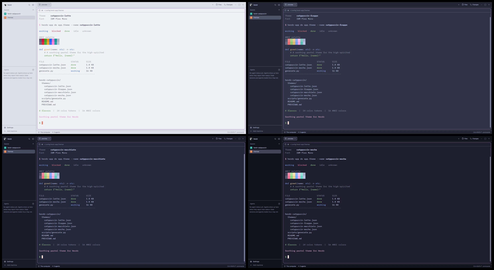

# Catppuccin for Herdr

An unofficial [Catppuccin](https://catppuccin.com) port for the
[Herdr](https://github.com/herdrdev/herdr-app) desktop app. It provides all
four Catppuccin flavors as Herdr theme files, generated from the official
palette and ANSI terminal color values.

The colors follow the official [Catppuccin style
guide](https://github.com/catppuccin/catppuccin/blob/main/docs/style-guide.md):
Base for the main pane, Crust and Mantle for secondary panes, Surface 0 and
Surface 2 for surface elements, Overlay 2 for selection, a Text and Subtext
hierarchy, a Mauve accent with Base text on accent-colored backgrounds, and
a Rosewater cursor. The terminal ANSI values are the official `ansiColors`
set.

The style guide gives broad recommendations rather than a Herdr token
specification. Where the guide leaves a role open, this port documents its
choice. For more information, see the [Conformance with the Catppuccin style
guide](#conformance-with-the-catppuccin-style-guide) section of this document.

> **This is not an official Catppuccin repository.** It is a community port,
> not affiliated with, maintained by, or endorsed by the Catppuccin
> organization. The Catppuccin palette and style guide are official projects,
> but this port is not.

The following preview shows Herdr in Latte, Frappé, Macchiato, and Mocha.



## Scope

This repository provides themes for the Herdr desktop app
(`herdrdev/herdr-app`). It doesn't target the Herdr command-line interface, its
terminal user interface, or the separate `herdr-desk` project.

## Flavors

Each flavor has a theme file and a preview image. The following table lists
each flavor with its theme file and preview.

| Flavor | Theme file | Preview |
| --- | --- | --- |
| Latte | [`catppuccin-latte.json`](themes/catppuccin-latte.json) | [Latte preview](assets/latte.webp) |
| Frappé | [`catppuccin-frappe.json`](themes/catppuccin-frappe.json) | [Frappé preview](assets/frappe.webp) |
| Macchiato | [`catppuccin-macchiato.json`](themes/catppuccin-macchiato.json) | [Macchiato preview](assets/macchiato.webp) |
| Mocha | [`catppuccin-mocha.json`](themes/catppuccin-mocha.json) | [Mocha preview](assets/mocha.webp) |

## Install

### Ask your agent

In Herdr, start an agent and paste the following prompt:

```text
Read ~/.config/herdr-app/AGENTS.md, then add or update these themes: github.com/edsvo/herdr-catppuccin. Use catppuccin-latte for light and catppuccin-mocha for dark.
```

Your agent reads the repository, adds the theme files to your Herdr themes
directory, and applies the pair. Change the flavor names in the prompt to
choose another pair. Run the prompt again to update installed themes.

### Install manually

To install without an agent, copy the theme files from this repository:

```sh
mkdir -p ~/.config/herdr-app/themes
cp themes/catppuccin-*.json ~/.config/herdr-app/themes/
herdr-app do app.theme --name catppuccin-mocha
```

You can also choose the theme in **Settings** > **Look** > **Theme**. The
Herdr home directory is `~/.config/herdr-app`. Set `HERDR_APP_HOME` to use
another location.

The preceding commands use Unix shell syntax. On Windows, use PowerShell:

```powershell
New-Item -ItemType Directory -Force "$HOME\.config\herdr-app\themes"
Copy-Item themes\catppuccin-*.json "$HOME\.config\herdr-app\themes"
herdr-app do app.theme --name catppuccin-mocha
```

To follow the system appearance, add this `theme` entry to `settings.json`:

```json
{
  "theme": { "light": "catppuccin-latte", "dark": "catppuccin-mocha" }
}
```

Herdr uses the theme that matches the active appearance. The Latte flavor is
a light theme. The Frappé, Macchiato, and Mocha flavors are dark themes.

## Theme generation

To install the themes, you only need the `themes/*.json` files. They are ready
to use as they are, so installation needs no Python and no build step.

[`scripts/generate.py`](scripts/generate.py) is for the less common case where
you want to change the themes. It keeps the official Catppuccin palette v5,
the official `ansiColors` values, and the token mapping in one place, then
generates all four flavors and validates the result.

Editing one flavor by hand is possible. The script keeps a change consistent
across all four flavors. Update the palette, ANSI values, or mapping, and the
script regenerates all four files with the same validation. Herdr themes are
standalone JSON with no variables or includes, so without the script the same
change would need to be repeated in four files.

Regenerate or verify the theme files:

```sh
python3 scripts/generate.py           # rewrite themes/*.json
python3 scripts/generate.py --check   # verify the files match
```

The `--check` mode, the generator tests, and a documentation link check run
in continuous integration on every push and pull request. `--check` verifies
hex formatting, token coverage, ANSI array length, and a set of contrast
checks.

The preview images in `assets/` are rebuilt separately. For more information,
see [Rebuild the previews](PREVIEWS.md#rebuild-the-previews).

## Compatibility

The themes target Herdr 0.1.16. The token mapping follows the `theme()`
definition in that release. If a later release adds or renames theme tokens,
update the mapping in `scripts/generate.py` and regenerate the theme files.

## Palette mapping

The themes map each Herdr token to a Catppuccin color. The following table
lists the mapping.

| Herdr token | Catppuccin color |
| --- | --- |
| `background` | Base (main pane) |
| `canvas` | Crust (area behind pane cards) |
| `chrome` | Crust (sidebars and bars) |
| `surface`, `popover` | Mantle (secondary panes) |
| `raised`, `hover` | Surface 0 (surface elements) |
| `selected`, `selection` | Overlay 2 at 30% over Base |
| `border` | Overlay 0 (inactive terminal border) |
| `input` | Surface 2 (surface elements) |
| `foreground` | Text |
| `muted` | Subtext 1 |
| `dim` | Overlay 1 |
| `accent` | Mauve |
| `accent_foreground` | Base |
| `ring` | Lavender (active terminal border) |
| `solid` | Mauve |
| `solid_foreground` | Base |
| `working` | Blue |
| `blocked` | Red |
| `done` | Green |
| `idle` | Overlay 1 |
| `unknown` | Overlay 0 |
| `cursor` | Rosewater |
| `ansi` | Official Catppuccin ANSI palette |

Herdr theme files use six-digit hex colors. The style guide recommends
Overlay 2 at 20-30% for selection. This port uses 30% and flattens it onto
Base. On Crust or Mantle surfaces, the opaque result is an approximation. The
guide does not name a UI accent or primary-button color. This port uses
Mauve, one of the Catppuccin accent colors, with Base text on accent-colored
backgrounds. The [Notes on choices and
limitations](#notes-on-choices-and-limitations) section documents these
choices and limitations.

## Conformance with the Catppuccin style guide

The palette and ANSI values match the official Catppuccin sources exactly.
Placement follows the guide where it makes a clear recommendation. The table
also records the choices the guide leaves open and the places where Herdr
cannot expose the recommended roles.

| Area | Catppuccin recommendation | This port | Status |
| --- | --- | --- | --- |
| Background pane | Base | `background` = Base | Matches |
| Secondary panes | Crust, Mantle | `canvas` and `chrome` = Crust, `surface` and `popover` = Mantle | Matches |
| Surface elements | Surface 0, 1, and 2 | `raised` and `hover` = Surface 0, `input` = Surface 2 | Matches |
| Body copy, headlines | Text | `foreground` = Text | Matches |
| Labels | Subtext 0 or 1 | `muted` = Subtext 1 | Matches |
| Subtle text | Overlay 1 | `dim` = Overlay 1 | Matches |
| On accent | Base | `accent_foreground`, `solid_foreground` = Base | Matches |
| Success | Green | `done` = Green | Matches |
| Errors | Red | `blocked` = Red | Matches |
| Selection | Overlay 2 at 20-30% | `selected`, `selection` = Overlay 2 at 30% over Base | Matches (flattened) |
| Cursor | Rosewater | `cursor` = Rosewater | Matches |
| Terminal ANSI | Official ANSI values | Exact match to `ansiColors` | Matches |
| Extended ANSI colors | Color 16 (Peach), color 17 (Rosewater) | 16 ANSI colors only | Not exposed |
| Links and tags | Blue | `ansi4` and `accent` = Mauve | No dedicated token |
| Warnings | Yellow | ANSI yellow only | Not exposed |
| Cursor text | Base (Latte), Crust (dark) | Not exposed | App limitation |
| Active terminal border | Lavender | `ring` = Lavender, but the default layout uses `accent` | Matches with layout setup |
| Inactive terminal border | Overlay 0 | `border` = Overlay 0 | Matches |
| Bell border | Yellow | No token | Not exposed |
| Code editor syntax | Mauve keywords, Peach numbers, and Overlay 2 comments | File viewer uses `ansi5`, `ansi1`, and `dim` | App limitation |
| Agent working | No explicit recommendation | `working` = Blue | Status-based choice |
| Agent idle and unknown | No explicit recommendation | `idle` = Overlay 1 and `unknown` = Overlay 0 | Status-based choice |
| UI accent and primary button | No explicit recommendation | `accent` and `solid` = Mauve, with Base text | Design choice |

### Notes on choices and limitations

- **Selection.** The style guide recommends translucent Overlay 2 at 20-30%.
  This port uses 30% and flattens it onto Base because Herdr needs six-digit
  hex. The result is exact on Base. Over Crust or Mantle, it is an
  approximation. `selected` and `selection` share the value because the guide
  has one selection background.
- **Secondary panes and chrome.** The guide allows Crust or Mantle. Herdr has
  a single `chrome` token that covers sidebars and bars, so that token uses
  Crust. `canvas` also uses Crust, and `surface` and `popover` use Mantle.
  The result is a three-step Base, Mantle, and Crust hierarchy.
- **Surface states.** The guide names Surface 0, 1, and 2 but does not map
  them to components. A component that needs more contrast can override these
  within the same family.
- **Accent and primary button.** The guide does not name a UI accent. This
  port uses Mauve, one of the Catppuccin accent colors, with Base text on
  accent-colored backgrounds. `solid` follows the same pair. Latte Mauve on
  Base is 4.79:1. Blue is used for the working status and is available as
  `ansi4`. Herdr has no dedicated link or tag token.
- **Agent statuses.** Blocked and done use the error and success colors from
  the table. The guide has no working or idle statuses, so working, idle, and
  unknown are status-based choices. The guide's warning color has no Herdr
  token.
- **Borders and focus.** `border` = Overlay 0 matches the guide's inactive
  terminal border. `ring` = Lavender matches its active terminal border. To
  use the guide's active border, set `focus.color` to `"ring"`. The default
  Herdr layout uses `accent` for pane focus. Herdr also uses `border` for UI
  dividers, which the guide does not map. Those dividers share Overlay 0.
- **Subtle text and syntax.** `dim` = Overlay 1 matches the guide's Subtle and
  line-number colors. The Herdr file viewer maps keywords to `ansi5` (Pink),
  numbers to `ansi1` (Red), and comments to `dim` (Overlay 1). The guide's
  syntax table uses Mauve for keywords, Peach for numbers, and Overlay 2 for
  comments. The theme supplies the official ANSI colors, but the file viewer
  controls how syntax maps to them.
- **Contrast.** The port keeps the official palette values. Latte Green is
  2.96:1 on Base, just below 3:1. Latte `muted` (Subtext 1) is 5.53:1 on
  Base, and Latte `accent` (Mauve) is 4.79:1 on Base. The accent is 4.09:1 on
  Crust, where it is used for indicators rather than body text. Latte `dim`
  and `idle` (Overlay 1) are 2.83:1 on Base, and `dim` is 2.42:1 on Crust.
  Latte `unknown` (Overlay 0) is 2.30:1. Latte `ring` (Lavender) is 2.81:1
  and `border` (Overlay 0) is 2.30:1 on Base. Frappé `unknown` and `border`
  (Overlay 0) are 2.87:1 on Base. These are subtle text, status, or non-text
  roles, and the style guide recommends the palette values, so they are kept.
  Selected rows use `foreground` for primary text, which is 5.13:1 on the
  Latte selection background. Secondary `muted` and `dim` text on a selected
  row is lower. The Changes panel uses `dim` for the path.

## Support

Open an issue to report a problem with a theme. Include the flavor name and a
screenshot if you can. This project does not accept pull requests.

## License

This port is released under the MIT License. See the [LICENSE
file](LICENSE). The port files are © 2026 Ed Svoboda.

Herdr is a separate project licensed under the Apache License 2.0. The
Catppuccin palette and style guide are © Catppuccin Org. See the [third-party
notices](THIRD-PARTY-NOTICES.md) for attribution.
